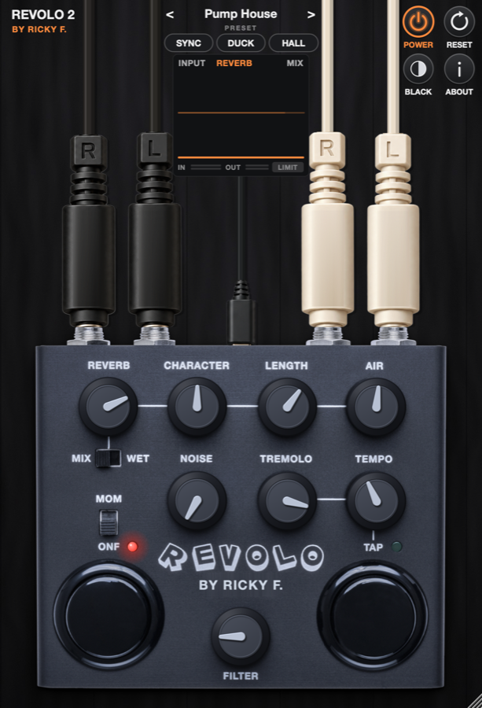
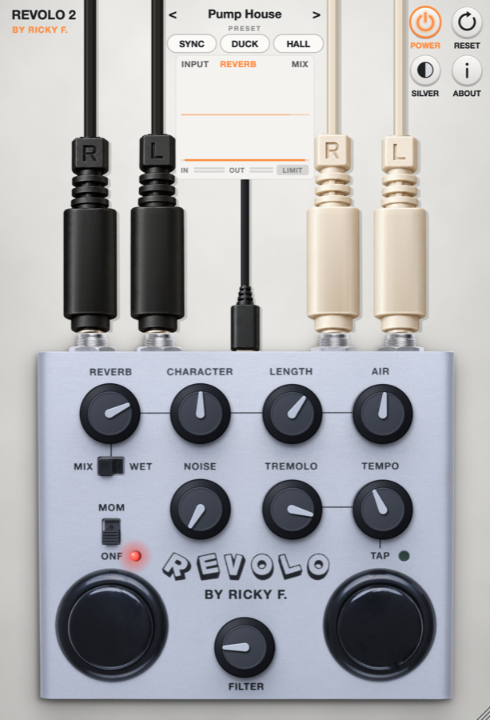
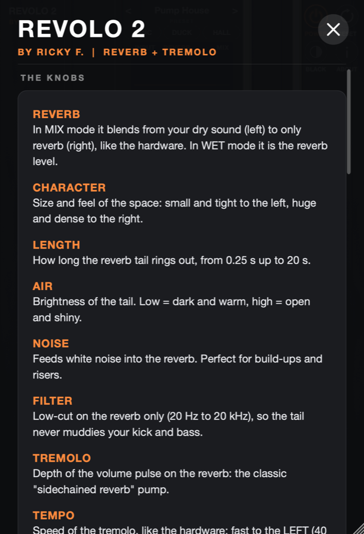
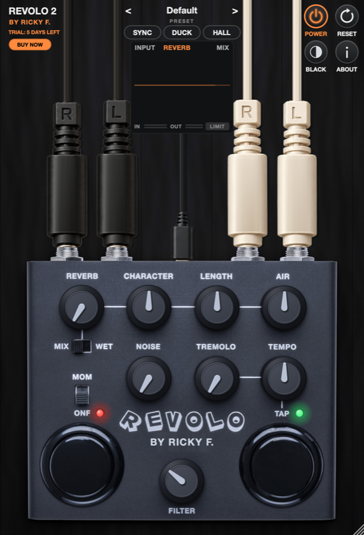

# Revolo 2 by Ricky F.

**Reverb + tremolo pedal plug-in for Ableton Live, FL Studio, Logic Pro and more.**
Plugin de reverb + trémolo para Ableton Live, FL Studio, Logic Pro y más.

**Version 2.0.0 · Free 7-day trial · Prueba gratis 7 días**

&nbsp;&nbsp;

---

## What it does · Qué hace

| | |
|---|---|
| **REVERB** | From your dry sound to a huge wash. MIX blends dry and reverb; WET is 100 % reverb for a Return track. |
| **CHARACTER · LENGTH · AIR** | Size of the space, 0.25 s to 20 s tails, and how bright they are. |
| **TREMOLO · TEMPO · TAP · SYNC** | A gater on the reverb: the classic "sidechained reverb" pump, free, tapped or locked to your DAW's tempo. |
| **NOISE** | White noise through the reverb, for risers and build-ups. |
| **FILTER** | Low-cut on the reverb only, so the tail never muddies the kick and bass. |
| **HALL · CLOUD · SPRING** | Three reverb types: smooth hall, dense cloud and drippy spring. |
| **DUCK** | The reverb steps back while you play and swells in the gaps. |
| **Presets** | 13 factory presets, plus your own. |
| **Clean output** | Built-in look-ahead limiter: it never clips. |

## Download & install · Descargar e instalar

**macOS** (Apple Silicon & Intel, macOS 11+): VST3 · AU · standalone app
1. Download **[Revolo2-Mac.pkg](https://github.com/rickyfloresmx/revolo2-downloads/releases/latest/download/Revolo2-Mac.pkg)** and double-click it.
2. If macOS says it can't verify the developer: **right-click → Open → Open**.
3. Restart your DAW or rescan plug-ins.

**Windows** (10/11, 64-bit): VST3 · standalone app
1. Download **[Revolo2-Windows.exe](https://github.com/rickyfloresmx/revolo2-downloads/releases/latest/download/Revolo2-Windows.exe)** and run it.
2. If Windows SmartScreen appears: **More info → Run anyway**.
3. The VST3 goes to `C:\Program Files\Common Files\VST3`. Restart your DAW or rescan plug-ins.

Works in **Ableton Live, FL Studio, Logic Pro (AU), Reaper, Bitwig, Cubase, Studio One** and any VST3 / AU host.

## Trial & license · Prueba y licencia

- **7-day free trial**, 10 minutes per session (reopen the plug-in to keep going).
- **BUY NOW** inside the plug-in, any time: **$20 USD (~$360 MXN)**, debit or credit card through Mercado Pago.
- Your key arrives on screen and by e-mail. Paste it in **ACTIVATE**: done.
- 1 license = 1 computer. Changing computers? Use **Deactivate** in the plug-in first.

**Prueba gratis 7 días** (10 minutos por sesión). Compra con **BUY NOW** dentro del plugin con tarjeta de débito o crédito; tu clave llega en pantalla y por correo.

 

## Updates · Actualizaciones

When a new version is out, the plug-in shows an **UPDATE** button. Download it and install over the old one: your license and presets stay.

---

© Ricky F. · Revolo 2 is an independent product.

